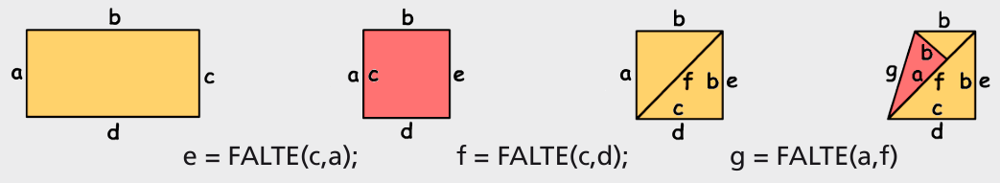

Antwort A ist richtig. Die Bilder beschreiben die Faltung A Schritt für Schritt:

Für die Faltung B lässt sich keine eindeutige Folge von Anweisungen programmieren: `e = FALTE(a,c); f = FALTE(a,b); g = FALTE(d,g)`. Für die dritte Anweisung gibt es zwei Möglichkeiten der Ausführung, von links her richtig, von unten her falsch. Für die Faltung C braucht man noch andere Anweisungstypen als nur FALTE, um die Lösung zu programmieren. Die Faltung D lässt sich so programmieren: `e = FALTE(c,a); f = FALTE(a,d); g = FALTE(a,f)`

## Das ist Informatik!

Funktionen sind ein wichtiges Konzept der Programmierung. Eine Funktion ist ein Programmteil, der mehr oder weniger viele Eingabe-Informationen bestimmter Struktur „akzeptiert“, abhängig von diesen Eingaben etwas Spezifisches tut und letztlich ein Ausgabe-Resultat „liefert“. Man sagt: Die Funktion akzeptiert Parameter (hier die Namen von zwei Kanten des Papiers), berechnet etwas (hier das nach der Faltung veränderte Aussehen des Papiers) und gibt ein Resultat zurück (hier den Namen einer neuen Kante). In der Informatik funktionieren Funktionen etwas anders als in der Mathematik.
