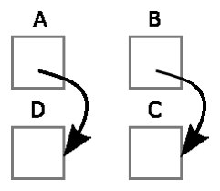
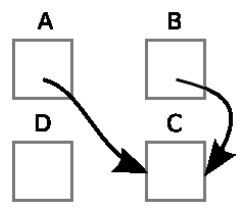
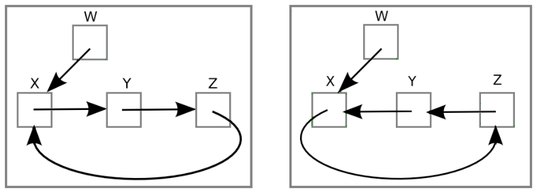

Die Anweisung `A <- B` ändert ein Bild mit Kästen und Pfeilen wie folgt: Der Pfeil von Kasten A zeigt nun auf denselben Kasten, auf den der Pfeil von Kasten B zeigt.

 

**Welche Folge von Anweisungen, nacheinander ausgeführt, ändert das linke Bild in das rechte Bild?**

