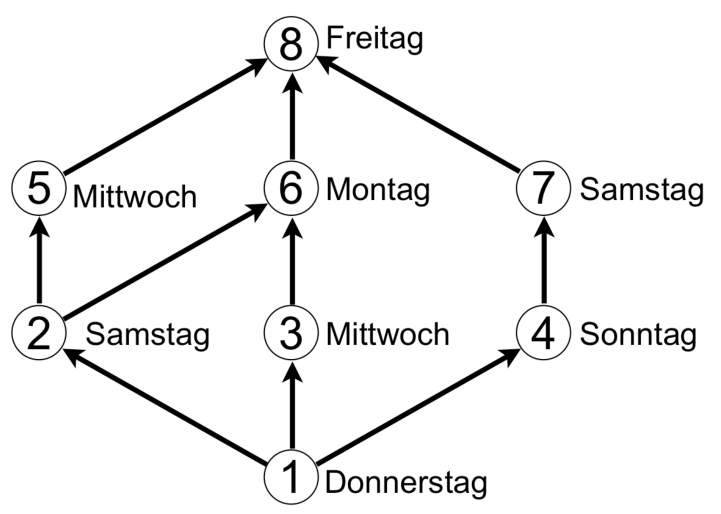

Im Wilden Westen, wo die Cowboy-Biber leben, hat die Bebras Stagecoach Company Postkutschenlinien zwischen acht Siedlungen (1 bis 8) eingerichtet. Im Fahrplan steht neben jeder Siedlung, an welchem Wochentag eine Postkutsche abfährt. Sie fährt jeweils frühmorgens los und erreicht am Abend desselben Tages die nächste Siedlung.

**Über welche Route wird ein Paket am schnellsten von Siedlung 1 nach Siedlung 8 transportiert?**
