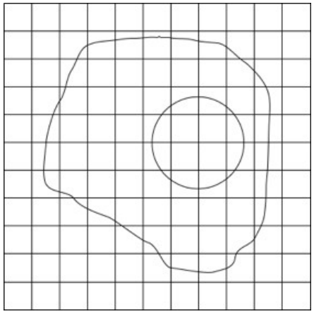

Die Biber malen Schwarzweißbilder. Das Bild vom Spiegelei gefällt ihnen. Sie speichern es auf dem Computer in einer Bilddatei mit 11 mal 11 Rasterkästchen.

Als sie die Bilddatei später wieder öffnen, sind sie überrascht: Die schön geschwungenen Linien sind nicht mehr zu sehen! Statt dessen sind alle Rasterkästchen, durch die eine Linie lief, komplett schwarz.

**Was sehen die Biber?**
