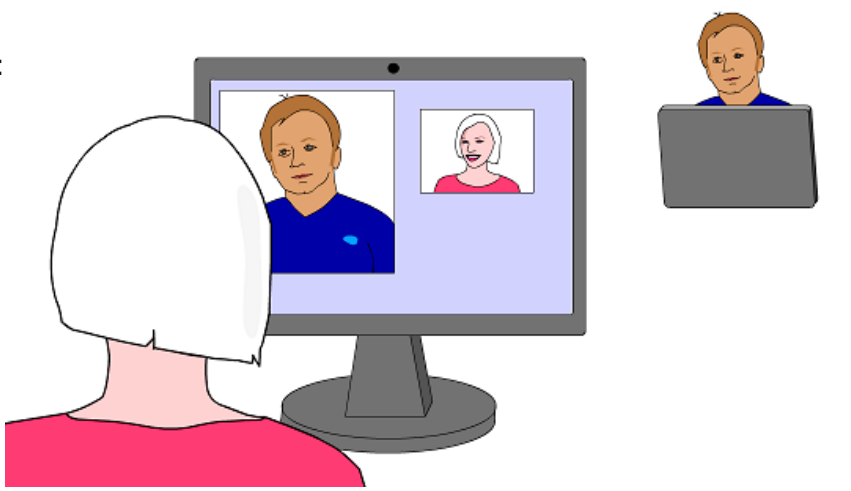

Hama und ihr Freund Horatio haben neue Computer bekommen. Die Computer haben eine eingebaute Kamera oben am Bildschirm. Wenn Hama nun mit ihrem Freund chattet, zeigt die Chatsoftware auf dem Bildschirm zwei Videofenster: Ein größeres, in dem sie Horatio chatten sehen kann, und ein kleineres, in dem sie sich selbst chatten sehen kann. Die Chatsoftware kann so eingestellt werden, dass sie Kamerabilder entweder „wie beim Foto“ zeigt (rechtes Auge auf dem Bildschirm links), oder „wie beim Spiegel“ zeigt (rechtes Auge auf dem Bildschirm rechts).

Hier chattet Hama mit Horatio:

**Wie ist die Chatsoftware auf Hamas Computer eingestellt?**
