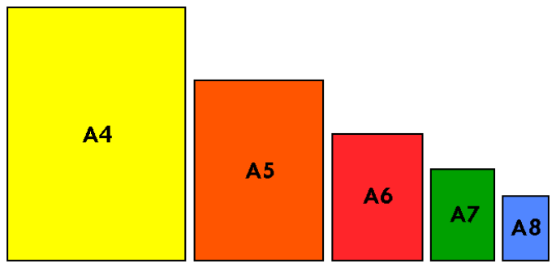

Du hast fünf Kartons, um daraus Kärtchen für ein Spiel zu machen. Jeweils ein Karton ist im Format A4, A5, A6, A7, A8. A4 ist doppelt so groß wie A5. A5 ist doppelt so groß wie A6. Und so weiter.

Du brauchst 12 Spielkärtchen im Format A8 und willst beim Zerschneiden keine Reste.

**Welche Kartons schneidest du ohne Schnittreste zu 12 Spielkärtchen?**
