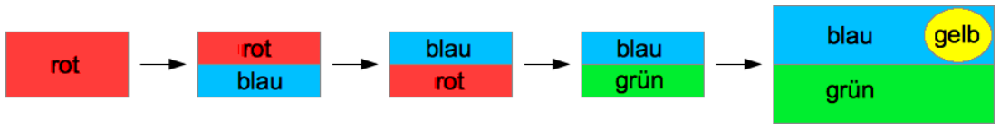

Eine einfache Stempelmaschine wird durch Programm-Karten gesteuert. Ein rotes Blatt Papier soll eingefärbt werden. Die Befehle auf den Programm-Karten sollen in der normalen Reihenfolge (1–2–3–4) ausgeführt werden:

1. Stempele die untere Hälfte blau (das wird der Himmel).
2. Drehe das Papier um 180 Grad.
3. Stempele die untere Hälfte grün (das sei das Gras).
4. Stempele oben rechts eine gelbe Scheibe (das sei die Sonne).

So soll sich das rote Papier verändern:

Unglücklicherweise kamen die Programm-Karten durcheinander und die Befehle wurden in der Reihenfolge (3 – 1 – 2 – 4) ausgeführt.

**Wie sah das Blatt Papier danach aus?**
