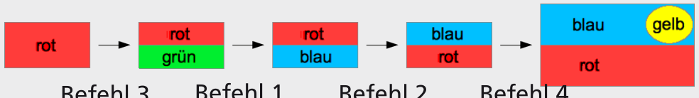

Antwort B ist richtig.

Antwort A würde durch die Reihenfolge (3 – 4 – 2) erzeugt. Antwort C würde durch die Reihenfolge (3 – 2 – 1 – 4) erzeugt. Antwort D würde durch die Reihenfolge (1 – 2 – 3 – 4) erzeugt.

## Das ist Informatik!

Die Änderung der Befehlsfolge eines Programms führt meist zu einem geänderten Verhalten dieses Programms. Programme bleiben selten während der gesamten Zeit ihrer Benutzung unverändert. Weitere Funktionen werden eingebaut (Upgrade), Anpassungen an eine sich verändernde technische Umgebung und die Korrektur entdeckter Fehler werden nötig (Update). Nach jeder Änderung eines Programms muss genau getestet werden, ob es noch in allen Fällen das erwartete Verhalten zeigt. Wenn sich durch das gut gemeinte Ändern neue Fehler in ein Programm eingeschlichen haben, spricht man von einer „Verschlimmbesserung“.
