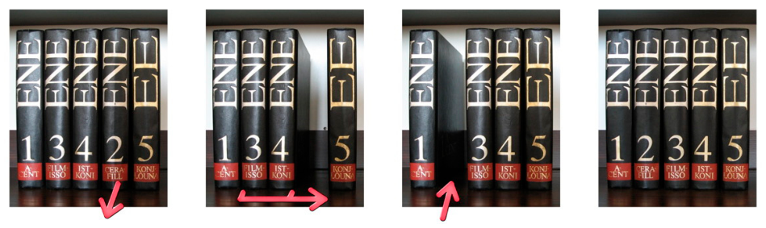
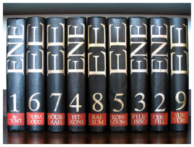

Ein Bibliothekar möchte die Bände einer Enzyklopädie in die richtige Reihenfolge bringen, mit so wenig Schritten wie möglich.

Ein Schritt geht so: Er nimmt einen Band aus dem Regal, verschiebt einige Bände zusammen nach links oder rechts und stellt den herausgenommenen Band ins Regal zurück. Im folgenden Beispiel werden fünf Bände in einem Schritt in die richtige Reihenfolge gebracht:

Eines Tages findet der Bibliothekar neun Bände in einer falschen Reihenfolge vor.

**Wie viele Schritte benötigt er mindestens, um diese Bände in die richtige Reihenfolge zu bringen?**
