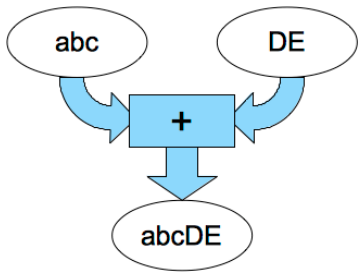
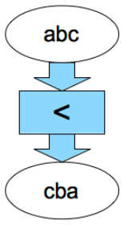
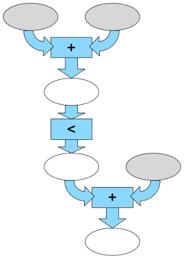

Wir haben hier zwei Arten von Textmaschinen: Eine +-Maschine (links) nimmt zwei Stückchen Text und schreibt sie hintereinander. Eine <-Maschine (rechts) nimmt ein Stückchen Text und schreibt es rückwärts.

 

Mit der Kopplung von zwei +-Maschinen und einer <-Maschine erhalten wir eine komplexere Textmaschine. Sie braucht drei Textstückchen (in den grauen Ellipsen) und schreibt Texte in die weißen Ellipsen.

**Welche drei Textstückchen braucht diese Textmaschine, um den Text INFORMATION in die unterste Ellipse zu schreiben?**
