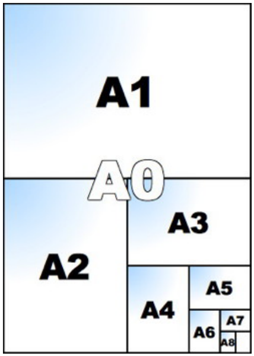

Standardgrößen für Papierformate werden festgelegt, indem man einen Papierbogen der Größe A0 (1189 mm × 841 mm) nimmt und wie in der Grafik dargestellt halbiert: Wenn man A0 halbiert, hat man A1. Wenn man A1 halbiert, hat man A2, usw.

Uns stehen acht Papierbögen zur Verfügung, je einer in der Größe A1, A2, A3, A4, A5, A6, A7 und A8. Wir wollen 19 Visitenkarten erstellen, die jeweils die Größe A8 haben. Dabei wollen wir nur ganze Bögen verwenden und keine zerschnittenen Reste übrig haben.

**Welche Papierbögen müssen wir also verwenden?**
