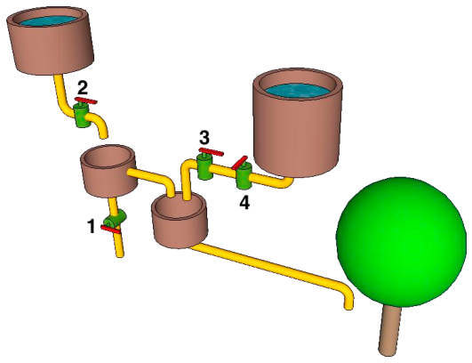

Der Biber hat ein Rohrsystem konstruiert, um seinen Apfelbaum mit Wasser zu versorgen. Die Ventile 1, 2, 3 und 4 können, unabhängig voneinander, offen oder geschlossen sein.

**In welchem Fall bekommt der Apfelbaum Wasser?**
