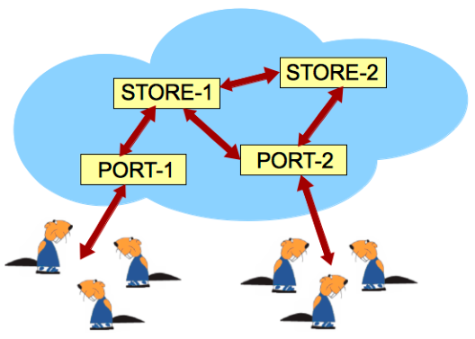

Die Castorianer speichern ihre Daten in einer Wolke mit vier Server-Computern. Das Bild zeigt alle Datenwege zwischen diesen Servern.

Für eine bessere Daten-Sicherheit sind alle Daten sowohl auf dem Speicher-Server STORE-1 als auch auf dem STORE-2 komplett gespeichert.

Für eine bessere Daten-Zugänglichkeit sind alle Daten sowohl über den Zugangs-Server PORT-1 als auch über den PORT-2 zugänglich.

Die Zugangs-Server speichern keine Daten der Castorianer.

**Welche Aussage ist FALSCH?**
