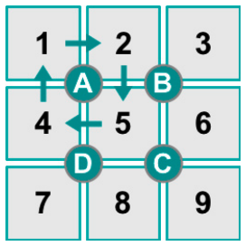
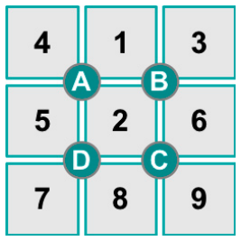

Im Spiel „Zahlendreher“ kann man die Zahlen 1 bis 9 durcheinander bringen. Zu Beginn einer Spielrunde sind die Zahlen immer wie im linken Bild platziert. Wenn man einen der Knöpfe A, B, C oder D drückt, werden die Zahlen rund um den Knopf im Uhrzeigersinn verdreht. Drückt man z. B. Knopf A, dann sind danach die Zahlen wie im rechten Bild platziert.

 

Du beginnst eine neue Spielrunde und drückst nun nacheinander folgende Knöpfe: **D, C, B, B.**

**Wo ist anschließend die Zahl 4 platziert?**
