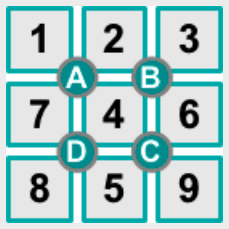
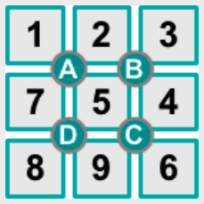
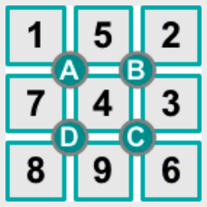
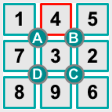

Antwort B ist richtig. Hier siehst du, was durch das Drücken der Knöpfe passiert:

   

## Das ist Informatik!

Wenn auf einem Computer Programme ablaufen, verändern sie seinen Zustand. Unterschiedliche Teilprogramme – wie hier die vier Knöpfe mit ihrer Funktion – können dabei gleiche Zustandselemente verändern. Im Spiel „teilen“ sich je zwei Knöpfe zwei Felder des Spielbretts. Auf das mittlere Feld haben sogar alle Knöpfe Einfluss. Damit keine Verklemmungen passieren, muss ausgeschlossen werden, dass Teilprogramme gleichzeitig versuchen, die gleichen Zustandselemente zu verändern. Die Informatik setzt hierzu das Konzept „atomare Operation“ ein. Atomare Operationen dürfen nicht unterbrochen werden – zwei atomare Operationen können also nur nacheinander ablaufen. Im Spiel ist das Drücken auf einen Knopf und die dadurch ausgelöste Verdrehung der Zahlen zusammengenommen eine atomare Operation.
