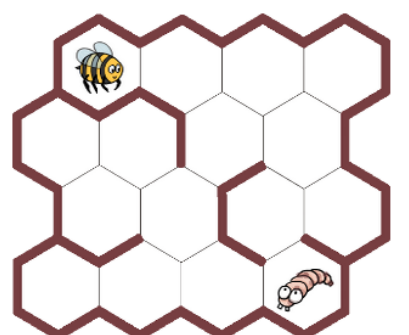

Die Biene soll der Larve Futter bringen.

Im Bienenstock kann die Biene sich von einer Wabe (Sechseck) zur nächsten bewegen. An manchen Stellen versperren ihr dicke braune Wände den Weg.

Die Biene braucht 5 Bewegungen, um zur Larve zu kommen. Die vierte Bewegung steht schon fest: Sie führt nach rechts unten.

**Zeige der Biene mit den Pfeilen einen Weg zur Larve!** Wähle fünf Pfeile; der vierte muss „rechts unten“ sein.
