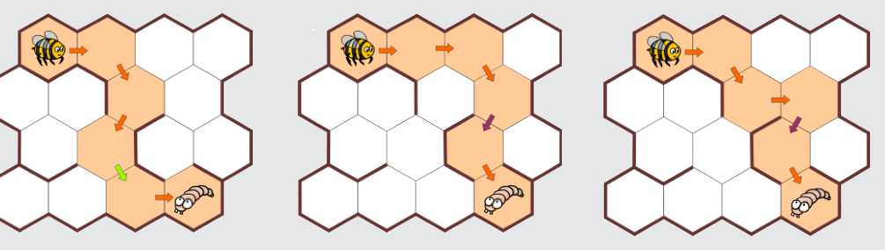

Es gibt drei Möglichkeiten mit 5 Bewegungen, aber nur bei einer Möglichkeit führt die vierte Bewegung nach rechts unten (rechts, rechts unten, links unten, rechts unten, rechts).

## Das ist Informatik!

Viele Ziele sind auf verschiedenen Wegen zu erreichen. In der Informatik geht es meist darum, einen optimalen Weg zum Ziel zu finden. Zum Beispiel den billigsten oder den verlässlichsten oder den kürzesten. Und dann gibt es eventuell noch Nebenbedingungen. Hier steht die Länge des Wegs bereits fest. Es muss nur noch die Nebenbedingung erfüllt werden, dass der vierte Schritt eine bestimmte Eigenschaft hat.
