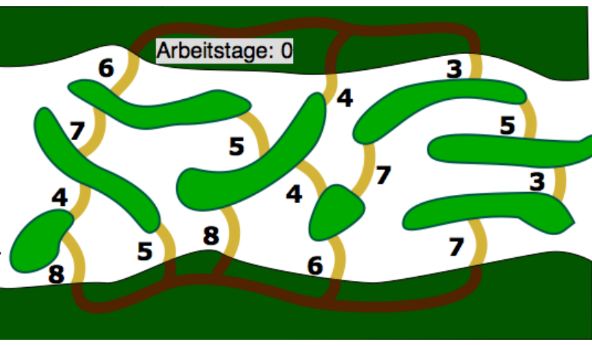

Im Fluss liegen viele Inseln. Biber Bob will Brücken bauen. Mit folgendem Ziel: Von beiden Flussufern aus soll man alle Inseln über Brücken und Uferwege erreichen können.

Bob will insgesamt möglichst wenige Tage arbeiten.

Im Plan hat Bob alle Stellen eingezeichnet, wo er eine Brücke bauen kann. Neben jeder Stelle steht, wie viele Arbeitstage er für den Bau dieser Brücke braucht.

**Zeige Bob, wie er mit möglichst wenigen Arbeitstagen sein Ziel erreichen kann!** Klicke im Plan auf die Stellen, wo Bob eine Brücke bauen soll. Klicke auf geplante Brücken, um sie wieder zu entfernen.
