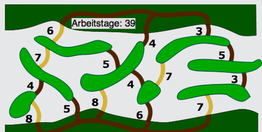

Bob braucht mindestens 39 Arbeitstage. Wird aus dieser Lösung irgendeine Brücke entfernt, dann ist mindestens eine Insel oder ein Ufer nicht mehr von überall erreichbar. Alle geplanten Brücken benötigen höchstens genauso viele Arbeitstage wie die nicht geplanten. Also muss die dargestellte Lösung auch eine bestmögliche sein.

## Das ist Informatik!

Wenn es um das Finden einer optimalen Lösung geht, hängt der Lösungsaufwand oft von der Anzahl der zu berücksichtigenden Einzelheiten ab – hier zum Beispiel von der Anzahl der Brücken und Inseln. Die Informatik kennt Problemtypen, wo sie trotz sehr vieler Einzelheiten einfach und schnell eine optimale Lösung zu finden weiß. Dazu gehört der Problemtyp „Minimaler Spannbaum“ in dieser Aufgabe. Die Lösung findet man mit dem „Kruskal-Algorithmus“, der im Kern so geht: „Baue bei jedem Lösungsschritt eine Brücke, für die du die wenigsten Arbeitstage brauchst und deren beide Inseln noch nicht über andere Brücken und Wege verbunden sind.“
