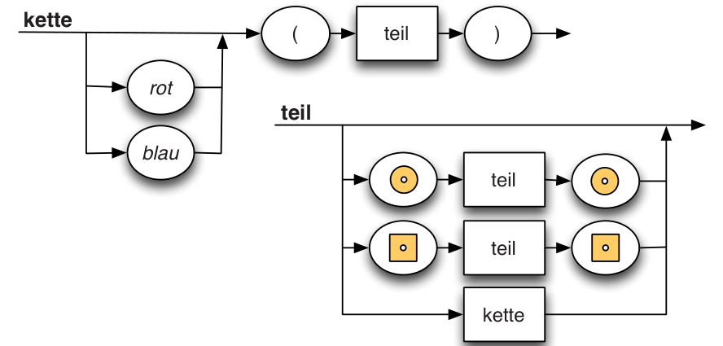

Die Kinder der kreativen Biberdame Grace basteln Perlenketten. Sie haben verschiedene Holzperlen (quadratisch und kreisförmig), die sie rot oder blau einfärben können. So können sie beispielsweise die folgende Kette basteln:

Grace erklärt den Kindern, dass diese Kette die folgende Kettenbeschreibung hat:

Grace fertigt nun zwei Zeichnungen an, die „kette“ und „teil“ heißen. Sie möchte nur Ketten haben, deren Kettenbeschreibung man erhalten kann, wenn man den Pfeilen in den Zeichnungen folgt:

Die kleinen Biber basteln vier Ketten. Leider passt nur eine zu Graces Zeichnungen.

**Welche?**
