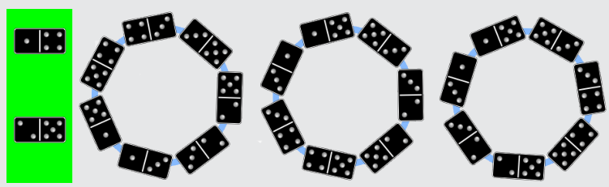
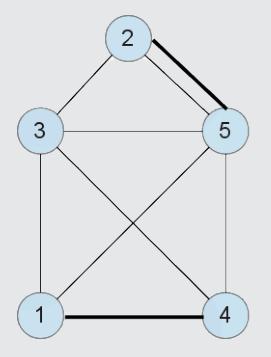

In einem Dominoring muss jede Augenzahl mit gerader Anzahl vorkommen (warum?). Bei den neun gegebenen Dominosteinen kommen die Augenzahlen 1, 2, 4 und 5 mit ungerader Anzahl vor. Mindestens zwei Dominosteine mit diesen Augenzahlen müssen deshalb übrig bleiben. Aus den anderen sieben Steinen kann man verschiedene Dominoringe legen; die Abbildung zeigt drei Beispiele.

Übrig bleiben der Stein 1|4 und ein Stein 2|5 (die beiden Steine 2|5 sind austauschbar).

## Das ist Informatik!

Auf den ersten Blick scheinen die Dominosteine die wichtigsten Objekte in diesem Problem zu sein. Aber die Augenzahlen (und ihre Häufigkeit) sind für die Lösung entscheidend. In einem „Graph“ kann man sie als Knoten darstellen; die Dominosteine sind dann die Kanten zwischen den Augenzahlen. Im „Dominosteingraph“ entsprechen die beiden dick gezeichneten Kanten den Dominosteinen, die nicht in den Dominoring passen.

Durch die Modellierung als Graph wird die Ähnlichkeit zu bekannten Problemen deutlich; Stichworte sind „Haus vom Nikolaus“ oder „Eulertour“. In der Informatik ist ein zweiter Blick auf ein Problem meist hilfreich!
