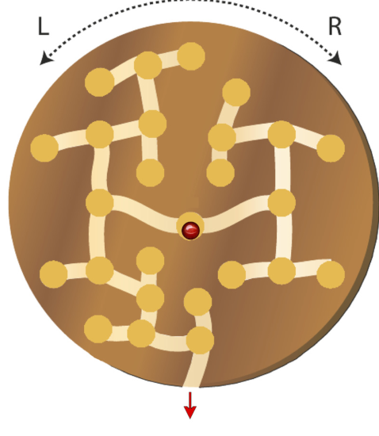

Würmer haben ein System von Nestern und Verbindungsgängen in eine Holzscheibe gefressen. Die Biber machen sich daraus ein Geschicklichkeitsspiel.

In das Nest in der Scheibenmitte kommt eine rote Glaskugel. Durch geschicktes Drehen der Holzscheibe nach Links (L) oder nach Rechts (R) soll die Glaskugel so bewegt werden: durch einen Verbindungsgang in ein benachbartes Nest.

Es ist das Ziel, die Glaskugel durch eine Folge von Drehungen von Nest zu Nest bis zum Ausgang zu bewegen.

**Welche Folge von Drehungen bewegt die Glaskugel zum Ausgang?**
