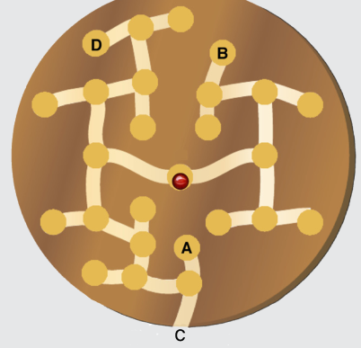

Antwort C ist richtig: Im Bild sieht man, wo die verschiedenen Folgen von Drehungen hinführen. Arbeitssparend ist die Beobachtung, dass man genau 6 Drehungen braucht, um die Glaskugel ins Ziel zu bewegen. Da bleiben nur A und C als mögliche Folgen.

## Das ist Informatik!

Das von den Würmern gefressene System von Nestern („Knoten“) und Verbindungsgängen („Kanten“) ist, als Datenstruktur gesehen, ein „binärer Baum“. Seine „Wurzel“ ist das Nest in der Scheibenmitte. Die Folgen von Drehungen sind „Pfade“ von der „Wurzel“ zu bestimmten „Blättern“. Eines dieser „Blätter“ ist der Ausgang.
