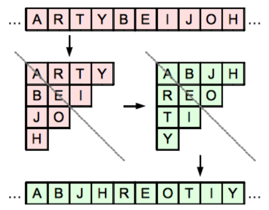

Betty möchte eine Nachricht an ihre beste Freundin schicken. Niemand sonst soll die Nachricht lesen können. Zuerst entfernt Betty alle Leerzeichen. Um den verbliebenen Text zu verschleiern, probiert sie das folgende Verfahren aus:

1. Der Text wird in Stücke eingeteilt, die 10 Zeichen (Buchstaben, Satzzeichen, …) lang sind.
2. Jedes Textstück wird in Form eines Dreiecks aufgeschrieben (wie im Bild).
3. Das Dreieck wird an einer diagonalen Achse gespiegelt (wie im Bild).
4. Das Dreieck wird wieder als Textstück geschrieben (wie im Bild).

Die beste Freundin erhält von Betty einen verschleierten Text, der folgendes Textstück enthält: ASA?LKRLLE

**Wie lautet dieses Textstück im unverschleierten Text?**
