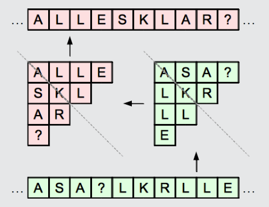

ALLESKLAR? ist richtig:

Das kann man sich leicht überlegen, indem man zur Entschleierung das Verfahren rückwärts anwendet. Man kann das Verfahren bei der Entschleierung sogar vorwärts anwenden, da es symmetrisch ist.

## Das ist Informatik!

Dieses einfache Verfahren zum Verschleiern von Nachrichten kann man als Variante der Skytale ansehen, die schon vor mehr als 2500 Jahren verwendet wurde. Wie alle solche Transpositionsverfahren lässt sich das Verfahren leicht knacken, vor allem wenn der zu verschleiernde Text länger ist. Im Gegensatz zu klassischen Verschlüsselungsverfahren wie der Caesar-Verschlüsselung oder der Vigenère-Verschlüsselung ist die Skytale rasch und ohne Aufwand anzuwenden. Die Informatik rät Betty, ein sehr viel sicheres Verfahren anzuwenden. Zum Beispiel das One-Time-Pad. Es ist mit geringem Aufwand zu verwenden und braucht auch nur Papier und Bleistift.
