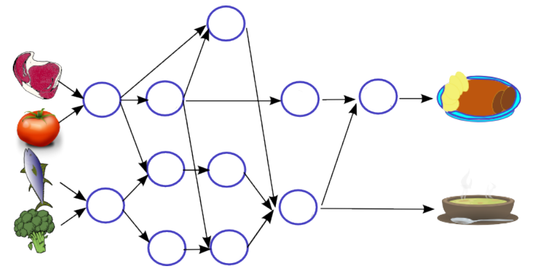

Anna und Ben kommen hungrig nach Hause. Nun möchten sie möglichst schnell zu Abend essen. Im Kühlschrank sind Brokkoli, Fisch, Tomaten und Fleisch. Daraus wollen sie zwei Gerichte zubereiten.

Die Zubereitung erfolgt in mehreren Schritten. Die meisten Schritte können Anna und Ben erst dann beginnen, wenn sie andere Schritte bereits erledigt haben.

Im Bild sind die Schritte als Kreise und die Abfolge der Schritte mit Pfeilen dargestellt.

Annas und Bens Herd hat drei Herdplatten. Sie können also maximal drei Schritte gleichzeitig erledigen. Für jeden Schritt benötigen sie 5 Minuten.

**Wie viele Minuten benötigen sie für die Zubereitung der beiden Gerichte mindestens?**
