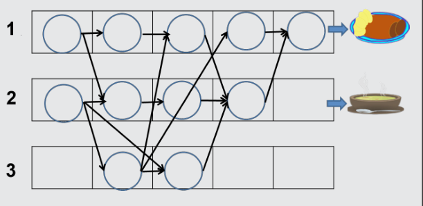

25 Minuten ist richtig:

Das Bild zeigt, wie die Schritte auf die drei Herdplatten verteilt werden können, um eine minimale Zubereitungszeit zu erreichen. Die Herdplatte 1 wird dabei für 5 Schritte benutzt. Somit ergeben sich 25 Minuten als minimale Zubereitungszeit.

## Das ist Informatik!

Will man ein Programm, das ein Computer ausführen soll, auf mehrere Prozessoren verteilen, so muss man dieses Programm in geeignete Teile zerlegen. Die Zuteilung an die Prozessoren sollte dann so geschehen, dass Programmteile möglichst wenig auf die Zwischenergebnisse anderer Programmteile warten müssen. Die Informatik arbeitet an immer besseren Algorithmen für dieses „job scheduling“.
