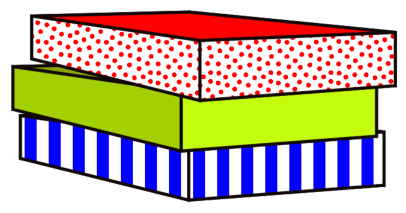
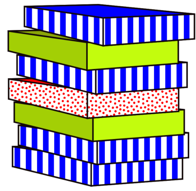

Tim ist Kuchenbäcker. Er backt immer drei Kuchen gleichzeitig. Sobald die drei Kuchen fertig sind, packt Tim sie in drei bunte Schachteln.

Die stapelt er immer gleich. Das siehst du auf dem Bild:

Den Dreierstapel bringt er sofort zum Verkäufer Tom. Der stellt den Dreierstapel zuoberst auf seinen Verkaufsstapel. Wenn Tom einen Kuchen verkauft, nimmt er immer die oberste Schachtel vom Verkaufsstapel.

Tim backt schneller als Tom verkaufen kann.

**Wie viele Kuchen hat Tom mindestens verkauft, wenn der Verkaufsstapel so aussieht?**
