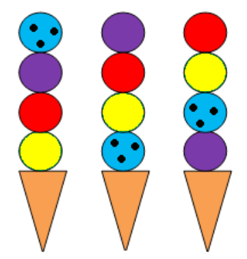

Diese spezielle Eismaschine erzeugt Tüten mit 4 Eiskugeln. Sie tut das in einer systematischen Weise.

Hier siehst du von links nach rechts die letzten 3 von der Eismaschine erzeugten Tüten:

**Welche Tüte wird die Eismaschine als nächstes erzeugen?**
