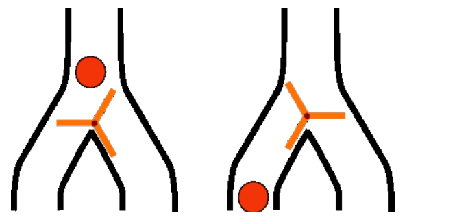
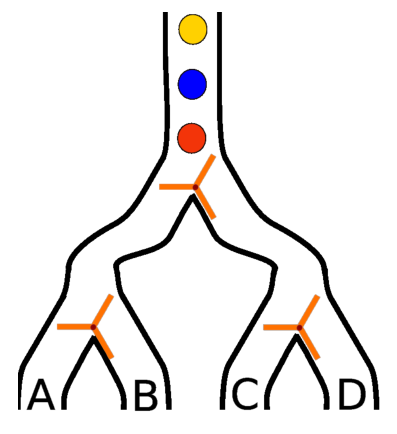

Das Flipflop ist ein Ding, das sich immer in einem von zwei möglichen Zuständen befindet. Jedes Mal, wenn es ein Signal erhält, wechselt das Flipflop seinen Zustand. Die Flipflops des Bibers arbeiten so:

Der Ball (das Signal) fällt von oben, und muss dann in eine der beiden möglichen Richtungen, links oder rechts, weiter fallen. Dabei dreht er das Flipflop so, dass der nächste Ball in die andere Richtung fallen wird.

Der Biber konstruiert sich mit solchen Flipflops ein Gerät, das so ausschaut:

**Aus welchem Rohr wird der dritte (gelbe) Ball fallen?**
