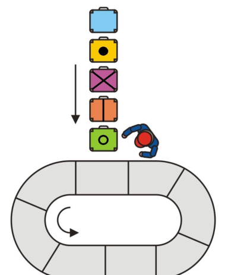

Das Förderband des Flughafens hat 8 Plätze und es dreht sich im Kreis (in Pfeilrichtung). Ein Arbeiter legt 5 Koffer der Reihe nach auf das Förderband.

Er legt den nächsten Koffer immer auf den drittnächsten leeren Platz. Er lässt also die schon belegten Plätze und auch zwei leere Plätze vorbei drehen.

Der Arbeiter ist fertig, wenn alle 5 Koffer auf dem Förderband liegen.

**Wie schaut das Förderband am Ende seiner Arbeit aus?**
