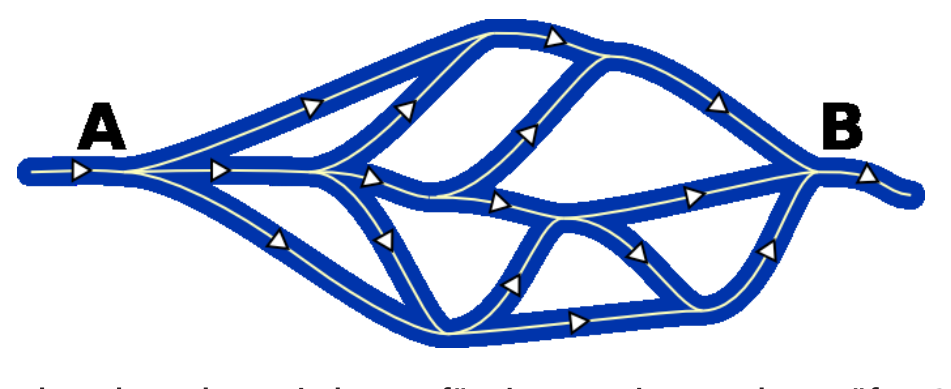

Die Biber veranstalten regelmäßig eine gemeinsame Fluss-Prüfung. Dafür muss durch jeden Flussarm mindestens ein Biber schwimmen. Die Biber starten gemeinsam in A und treffen sich wieder in B. Jeder Biber schwimmt nur einmal mit der Strömung von A nach B.

**Wie viele Biber braucht es dann mindestens für eine gemeinsame Fluss-Prüfung?**
