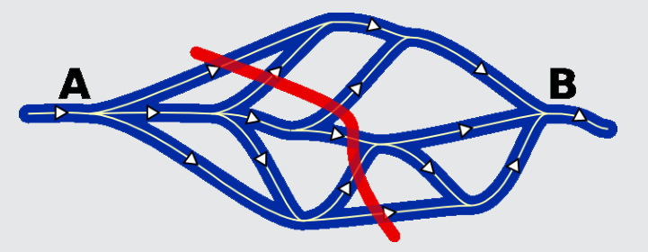

Antwort D ist richtig: Es braucht mindestens 6 Biber.

- Einer schwimmt linksaußen herum,
- einer rechtsaußen herum.
- Einer schwimmt „mitte, links“.
- Einer schwimmt „mitte, mitte, links“.
- Einer schwimmt „mitte, mitte, rechts, links“.
- Einer schwimmt „mitte, rechts, links, rechts“.

Die rote Linie im Flussplan schneidet 6 Flussarme. Es ist nicht möglich, dass ein Biber auf seinem Weg von A nach B zwei dieser Flussarme entlangschwimmt. Und es gibt keine solche Linie, die mehr als 6 Flussarme schneidet. Also genügen 6 Biber.

## Das ist Informatik!

Das System von Flussarmen kann als gerichteter Graph modelliert werden, wobei die Verzweigungen den Knoten, die Flussarme den Kanten und die rote Linie dem maximalen Schnitt des Graphen entsprechen. Für die meisten Flussprobleme kennt die Informatik effiziente Lösungsalgorithmen, die vielfältige Anwendungen in der Planung und Optimierung von Logistiknetzen und Kommunikationsnetzen haben. Aber das Problem, den maximalen Schnitt eines Graphen zu berechnen, ist NP-vollständig: <http://de.wikipedia.org/wiki/Maximaler_Schnitt>
