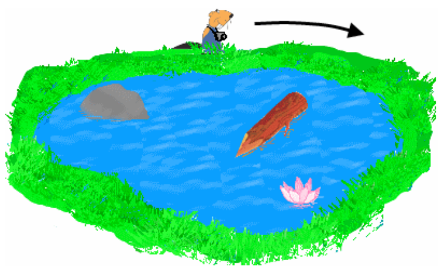

Der Biber spaziert um einen Teich. Er beginnt an der im Bild gezeigten Stelle und geht in Richtung des Pfeils.

Auf seinem Spaziergang macht er diese 4 Fotos, aber nicht in dieser Reihenfolge.

**Bringe die Fotos in die richtige zeitliche Reihenfolge!**
