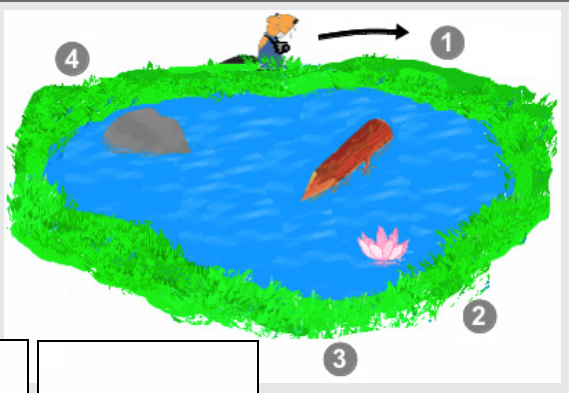

Die Fotos hat der Biber ungefähr an den folgenden Positionen gemacht:

Die richtige zeitliche Reihenfolge der Bilder ist also: Foto B (Seerose, Biber, Stein), Foto D (Stein, Seerose, Baumstamm), Foto A (Stein, Baumstamm, Seerose), Foto C (Baumstamm, Seerose, Stein).

## Das ist Informatik!

Es heißt: „Ein Bild sagt mehr als tausend Worte“, und wenn es mehrere zusammengehörige Bilder sind, dann ergibt die Analyse womöglich viel Interessantes. Momentan können Computer nicht menschengleich „verstehend“ sehen, aber eine Reihe sehr unterschiedlicher Fachgebiete der Informatik entwickeln schon erfolgreich spezielle Sehleistungen für autonome Robotfahrzeuge, gesichtserkennende Überwachungskameras, etc. Für noch „intelligentere“ Hinguck-Software gäbe es wohl sehr viele wünschenswerte und sehr viele nicht wünschenswerte Anwendungsmöglichkeiten.
