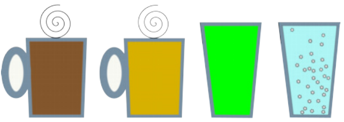

Oh nein! Der neue Getränkeautomat hat nur zwei Tasten: Taste A und Taste B. Es sollen aber vier Getränke zur Wahl stehen: Die Heißgetränke Kaffee und Tee sowie die Kaltgetränke Apfelsaft und Mineralwasser.

Der schlaue Hausmeister programmiert den Automaten so, dass durch ein Drücken von zwei Tasten die vier Getränke wählbar sind: Drücke zuerst die Taste A für Heißgetränk oder die Taste B für Kaltgetränk. Dann drücke die Taste A für Kaffee oder die Taste B für Tee, beziehungsweise die Taste A für Apfelsaft oder die Taste B für Mineralwasser.

Leider will der Hausmeister keine Benutzungsanleitung herausrücken. Deshalb kursieren unter den Schülern verschiedenste Anweisungen zur Benutzung des Getränkeautomaten. Nicht alle sind richtig. Beispiel für eine richtige Anweisung: Drücke erst Taste B und dann Taste A für Apfelsaft.

**Welche Anweisung ist richtig?**
