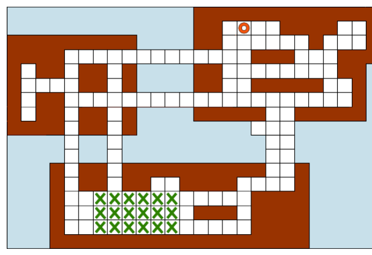

Igodots Inseln sind von einem Wegenetz aus quadratischen Platten durchzogen und über Brücken verbunden. Igodot bewegt sich von Platte zu nächster Platte in je einer Minute. Er biegt stets in rechten Winkeln ab und bewegt sich niemals diagonal.

Igodot ist gerade irgendwo auf dem Feld (mit Kreuzen markiert) und ruft zu Hause (mit Ring markiert) an, dass er nun auf dem kürzesten Weg nach Hause kommen wird.

**Wie lange muss man zu Hause auf Igodot warten?**
