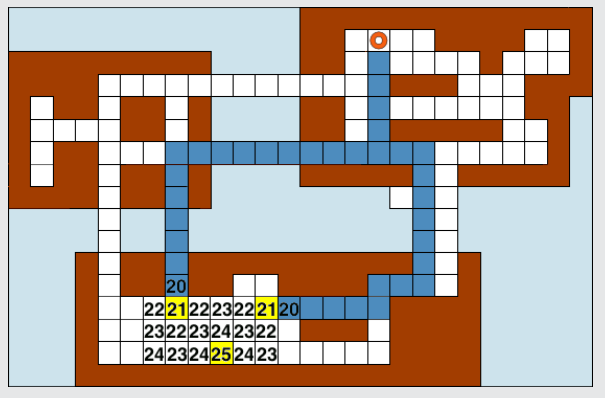

Antwort C ist richtig: Igodot braucht mindestens 21 Platten und höchstens 25 Platten. Die Alternativen mit „genau“ scheiden von vornherein aus, weil nicht alle Feld-Quadrate gleich weit von zu Hause entfernt sind.

## Das ist Informatik!

Vieles wissen wir nur ungefähr. Vieles wissen wir nicht sicher. Vieles wissen wir nur lückenhaft. Wie beschreibt man solch unvollkommenes Wissen formal, damit man es in Computern speichern und damit rechnen und planen kann? Die unterschiedlichsten Teilgebiete der Informatik arbeiten an dieser Frage. Ihre Themen reichen von „Intervallarithmetik“, „Statistik“ und „Mustererkennung“ bis „Fuzzy Logic“, „Künstliche Intelligenz“ und „Epistemologie“. Da ist unser Warten auf Igodot ein überschaubares Problem. Oder nicht? Wenn er zum Spaß doch einen Umweg macht? Wenn er unterwegs noch ein Schwätzchen hält? Vielleicht kommt er niemals nach Hause? Gibt es ihn überhaupt?
