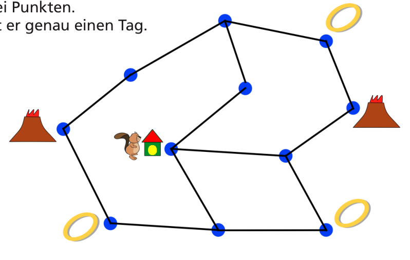

Hobbiber geht auf Knobelreise. Er muss drei Ringe holen und sie in einen Vulkan werfen. Erst dann darf er zu seinem Haus zurückkehren.

Hobbiber hat eine Landkarte mit allen Strecken, gezeichnet als Linien zwischen zwei Punkten. Um eine Strecke zu laufen, braucht er genau einen Tag.

Er kann eine Strecke mehrmals laufen.

Er muss nicht alle Strecken ablaufen.

**Wie viele Tage braucht Hobbiber mindestens für seine Knobelreise?**
