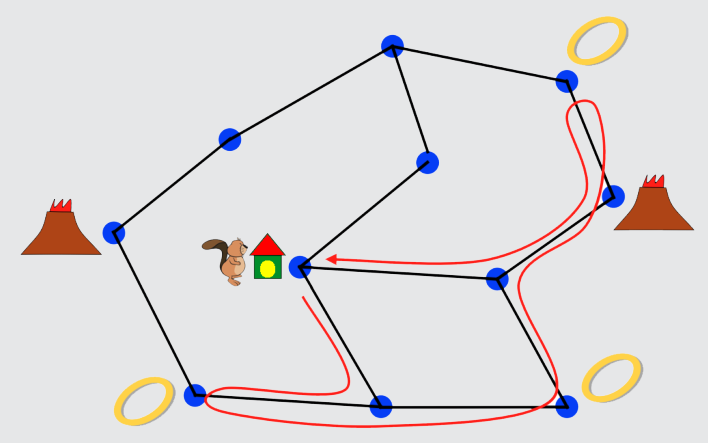

10 Tage ist richtig: Nach 2 Tagen hat Hobbiber den ersten Ring. Nach 4 Tagen den zweiten. Nach 7 Tagen alle drei Ringe. Die wirft er nach 8 Tagen in den rechten Vulkan und ist nach 10 Tagen zu Hause. Kürzer geht es nicht.

## Das ist Informatik!

Hier wird in einem Graph ein Weg gesucht, der eine ganze Reihe von Bedingungen erfüllen soll. Hat man durch Herumprobieren plus Nachdenken oder Zufall einen Weg gefunden, ist es nicht leicht zu entscheiden, ob dieser Weg ein „kürzester“ ist. Die Informatik hat deshalb viele Methoden zur Suche nach einem Optimum entwickelt. Bei einigen dieser Methoden ist eine gute – aber nicht optimale – Lösung schnell gefunden. Damit kann man sich insbesondere dann zufrieden geben, wenn abschätzbar ist, dass das Optimum nur wenig besser, aber aufwändig zu finden sein wird.
