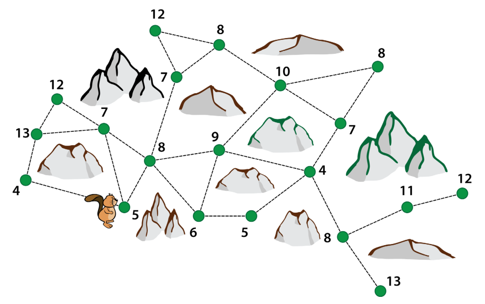

In der Karte sind einige Bäume als Punkte eingezeichnet. Dazu ist ihre Höhe eingetragen. Der Biber kann nicht weit sehen, weil es viele Felsen gibt. Wenn er von einem Baum aus einen anderen doch sehen kann, ist eine Linie zwischen den zwei Punkten eingezeichnet.

Der Biber möchte den höchsten Baum fällen, den er finden kann. Er beginnt die Suche beim Baum mit der Höhe 5. Von dort aus sieht er Bäume mit den Höhen 4, 7 und 8. Von seinem Standort aus geht er zum höchsten Baum, den er sehen kann. Zu Beginn ist das ein Baum mit der Höhe 8. Auf die gleiche Weise sucht er weiter nach einem noch höheren Baum. Die Suche endet erst, wenn der Baum an seinem Standort höher ist als alle Bäume, die er von dort aus sehen kann. Diesen Baum fällt er.

**Wie hoch ist der Baum, den der Biber fällt?**
