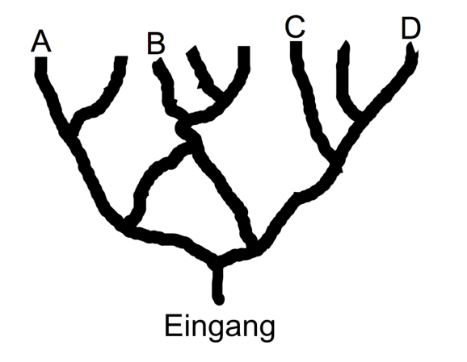

21 Höhlenforscher wollen ein Höhlensystem erforschen. Sie starten am Eingang und gehen bei Verzweigungen stets tiefer in das Höhlensystem hinein. Sie entfernen sich also immer weiter vom Eingang. Bei einer Verzweigung teilen sich die Höhlenforscher auf: Gleich viele Personen gehen nach links und nach rechts. Bei ungerader Personenzahl geht eine Person mehr nach rechts.

**An welcher Stelle werden am Ende die meisten Höhlenforscher ankommen?**
