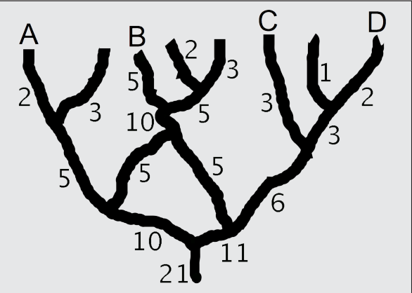

Antwort B ist richtig: Das Bild zeigt die Aufteilung der Personen an den Verzweigungen.

## Das ist Informatik!

Die Suche in einer verzweigten Höhle kann durch einen Graphen modelliert werden. Jeder Gang ist eine Kante und jede Verzweigung ein Knoten. Durch die Vorgabe der Geh-Richtung („stets weiter in das Höhlensystem hinein“) erhalten die Kanten eine Richtung, und der Höhlengraph wird zu einem „gerichteten azyklischen Graph“ (engl.: directed acyclic graph). So gehen die Höhlenforscher nicht im Kreis. <http://en.wikipedia.org/wiki/Directed_acyclic_graph>
