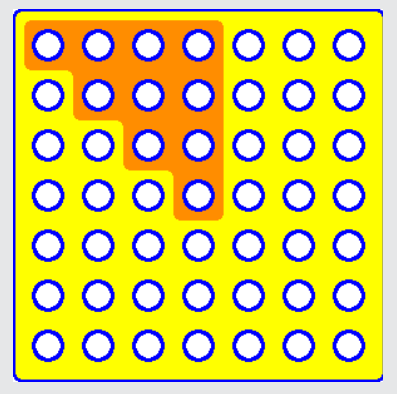

Antwort C ist richtig: Wegen der vierfachen Symmetriebedingung ist nur eine Teilfläche von 10 Codepunkten unterscheidend. Alle anderen Codepunkte ergeben sich daraus zwangsläufig. Jeder Codepunkt ist binär, Loch oder nicht Loch. Das ergibt 2 hoch 10 = 1024 mögliche Codes.

## Das ist Informatik!

Informatiksysteme werden (meist) von Menschen benutzt. Und Menschen machen gelegentlich Fehler. Deshalb ist ein System besonders gut benutzbar, wenn es unter anderem fehlertolerant ist. Das Informatiksystem „Zimmerschlüssel und Zimmerschloss“ ist fehlertolerant, weil es egal ist, wie herum der Schlüssel ins Schloss gesteckt wird. Erreicht wird dies durch Redundanz: der Schließcode ist gleich achtmal im Schlüssel enthalten.
