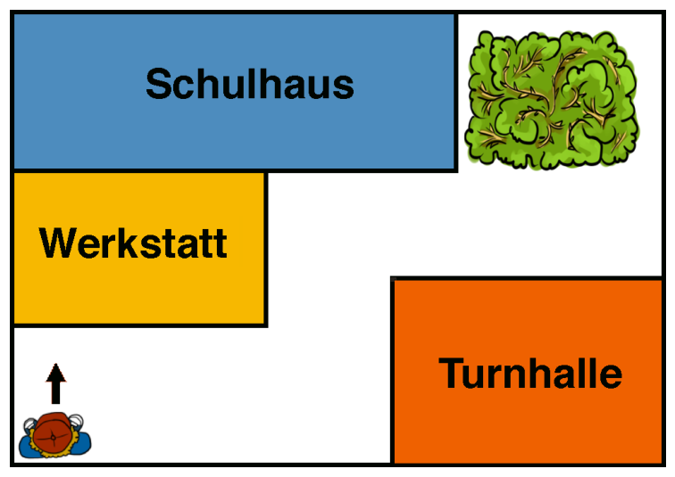

Die Kinder spielen Roboter. Jeremy ist der Roboter und hört nur noch auf diese drei Kommandos: Vor!, Links! und Rechts!

Rufen die Kinder Vor!, dann geht Jeremy vorwärts, bis er an ein Gebäude stößt. Rufen die Kinder Links!, dann dreht sich Jeremy nach links. Rufen sie Rechts!, dann dreht er sich nach rechts.

Jeremy steht in einer Schulhofecke. Man sieht ihn im Bild von oben. Er schaut in Richtung der Werkstatt. Die Kinder wollen ihn nun zur anderen Seite des Schulhofs hinter den Busch steuern.

**Welche Folge von Kommandos können die Kinder rufen, um Jeremy hinter den Busch zu steuern?**
