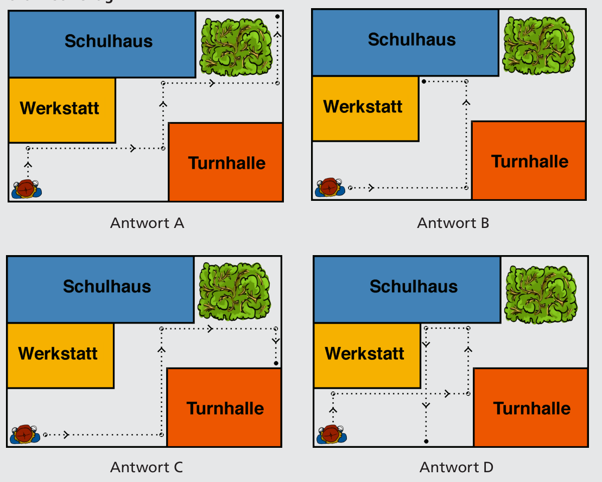

Antwort A ist richtig:

## Das ist Informatik!

Die Aufgabe handelt von der Steuerung von Robotern. Die Kommandos, die ein Roboter befolgen kann, sind seine Programmiersprache. Folgen von Kommandos sind seine Programme. Es gibt viele verschiedene Robotertypen: Zum Beispiel auf Rädern rollende, mit Propellern fliegende, auf einem Bein hüpfende, auf mehreren Beinen laufende, im Wasser tauchende, im Weltraum herumdüsende. Manche haben Arme und Greifer. Manche können mit Kameras sehen, mit Mikrophonen hören, mit Tastern fühlen. Je vielseitiger die Sensorik und die Aktorik eines Robotertyps ist, desto vielseitiger ist seine Programmiersprache.
