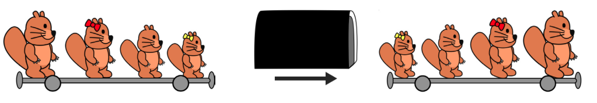
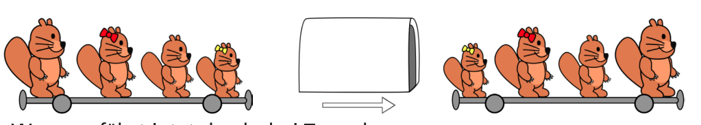
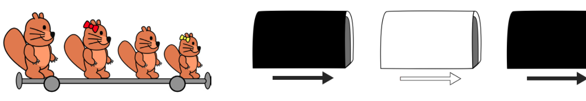

Die Biber-Bahn kennt zwei Sorten Tunnel. Fährt ein Waggon durch einen schwarzen Tunnel, kommen die Passagiere in umgekehrter Reihenfolge wieder heraus:

Fährt ein Waggon durch einen weißen Tunnel, sind der erste und der letzte Passagier vertauscht:

Dieser Waggon fährt jetzt durch drei Tunnel:

**In welcher Reihenfolge kommen die Passagiere aus dem letzten Tunnel?**
