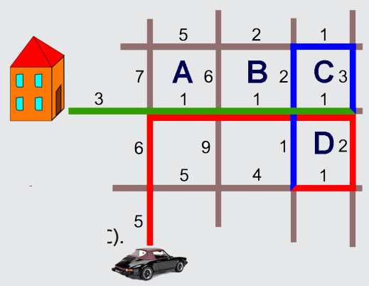

Antwort D ist richtig: Der schnellste Weg ist um Block D herum und dann um Block C herum. Man braucht 30 Minuten: 5+6+1+1+1+2+1 für das rote Stück. 1+2+1+3 für das blaue Stück und 1+1+1+3 für das grüne Stück. Alle anderen Wege ergeben eine längere Fahrtdauer. Die Fahrt um den Block A braucht 33 Minuten (Antwort A). Die Fahrt um die Blöcke A und B braucht 32 Minuten (Antwort B). Die Fahrt um die Blöcke A, B und C braucht 35 Minuten (Antwort C).

## Das ist Informatik!

In der Informatik ist es oft eine Problemstellung, einen Pfad zu finden, der einen minimalen Aufwand erfordert – und zwar unter Beachtung von Randbedingungen wie den Zeitdauern für die Streckenabschnitte und dass man nicht links abbiegen kann. Oft ist die Anzahl der in Frage kommenden Pfade zu groß, um sie alle zu untersuchen, ob sie einer mit minimalem Aufwand sind. Dann sollte man die Anzahl der zu untersuchenden Pfade sinnvoll eingrenzen. In unserer Aufgabe beschränken wir uns auf ein paar Häuserblöcke in der Umgebung von zu Hause. Dafür nehmen wir in Kauf, dass wir eventuell einen Pfad mit einem noch geringeren Aufwand als 30 Minuten verpassen, weil der außerhalb unseres Untersuchungshorizonts (unseres Bildes) liegt.
