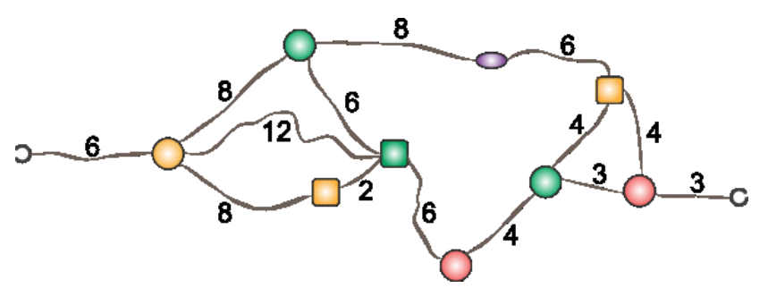

Kim hat sich aus bunten Perlen eine Halskette geknüpft. Ob sie auch um den Hals passt?

Die Zahlen geben in Zentimetern die Länge der Schnüre zwischen den Perlen an. Links und rechts sieht man die Verschlüsse.

**Welchen Umfang darf Kims Hals höchstens haben, damit die Kette noch herum passt?**
