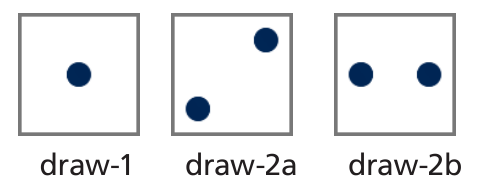
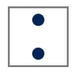
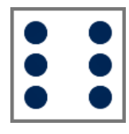

Die drei Befehle „draw-1“, „draw-2a“ und „draw-2b“ lassen diese Punktemuster entstehen:

Der Befehl „turn90“ dreht das bisher entstandene Punktmuster um 90 Grad im Uhrzeigersinn. Indem mehrere Befehle hintereinander ausgeführt werden, können viele unterschiedliche Punktmuster entstehen. Zum Beispiel lässt die Befehlsfolge „draw-2b, turn90“ dieses Punktemuster entstehen:

Und die Befehlsfolge „draw-1, draw-2a, turn90“ lässt dieses Punktemuster entstehen:

**Welche Befehlsfolge lässt dieses Punktemuster entstehen?**
